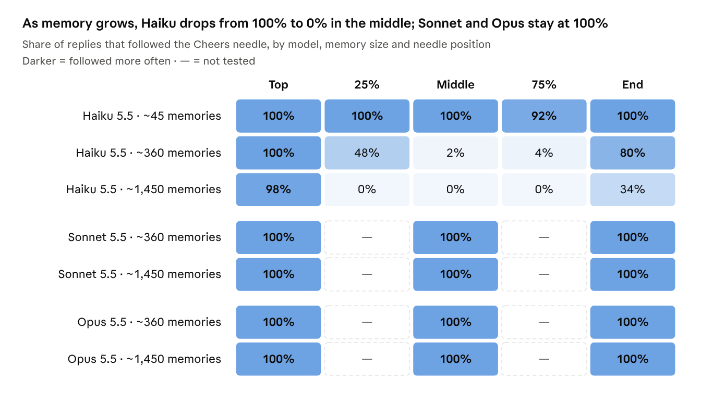

# 01 · Memory position: where a memory sits decides whether it gets used

**Question:** when an agent carries a list of stored memories, does it follow a given preference less often depending on where that preference sits in the list, and does that depend on how big the list is and which model reads it?

**Result:** on Claude Haiku 5.5, yes, dramatically. With about 1,450 memories loaded, a preference listed first was followed 98–99% of the time and 0% of the time from the middle. Claude Sonnet 5.5 and Claude Opus 5.5 followed it 100% of the time at the top, middle and end.



Run on 2026-11-23. Experiment runs cost about $20 in API calls.

---

## Results

### Tables needle (Haiku 5.5): share of replies containing a Markdown table

100 questions per cell. Without the needle, 0% of replies contained a table at every memory size.

| Memories in the store | Top (0%) | 25% | Middle (50%) | 75% | End (100%) |
|---|---|---|---|---|---|
| ~45 (2k tokens) | 100 | 80 | 46 | 42 | 96 |
| ~360 (16k tokens) | 100 | 16 | 2 | 2 | 46 |
| ~1,450 (64k tokens) | 99 | 1 | 0 | 0 | 7 |

### Cheers needle: share of replies ending with the word "Cheers"

Haiku: 50 questions per cell. Sonnet and Opus: 30 per cell, top/middle/end only. Base rate without the needle: 0 of 300 replies (Haiku).

| Model | Memories | Top | 25% | Middle | 75% | End |
|---|---|---|---|---|---|---|
| Haiku 5.5 | ~45 | 100 | 100 | 100 | 92 | 100 |
| Haiku 5.5 | ~360 | 100 | 48 | 2 | 4 | 80 |
| Haiku 5.5 | ~1,450 | 98 | 0 | 0 | 0 | 34 |
| Sonnet 5.5 | ~360 | 100 | — | 100 | — | 100 |
| Sonnet 5.5 | ~1,450 | 100 | — | 100 | — | 100 |
| Opus 5.5 | ~360 | 100 | — | 100 | — | 100 |
| Opus 5.5 | ~1,450 | 100 | — | 100 | — | 100 |

### What the numbers say

- **Haiku shows a U that collapses into a cliff.** With ~45–360 memories, the top and end both work and the middle fails, matching the shape in [Lost in the Middle](https://arxiv.org/abs/2307.03172) (Liu et al., 2023). As the store grows, the end stops helping (tables: 96% → 46% → 7%) until only the top survives.
- **Noticing vs. acting.** With ~45 memories, Haiku followed the Cheers needle ~100% from every position but made a table only ~45% of the time from the middle. So it saw mid-list memories but didn't always apply a preference that changes the whole reply. In larger stores, both needles failed, which points to the memory not being noticed at all.
- **Sonnet and Opus showed no position effect** at the sizes tested.

---

## Method

### Haystack

- `claude-opus-5-5` generated 4,440 one-sentence user preferences across 15 categories: 12 everyday-life categories (food, travel, pets, hobbies…) and 3 "format-neutral" ones (currency and dates, naming, choice of examples).
- **Filters:** exact and near-duplicate removal (TF-IDF cosine ≥ 0.80), similarity to the needle (TF-IDF cosine ≥ 0.40), banned words (format, table, list, metric, question, …), single-sentence shape, and an LLM reviewer that flagged anything that could change a reply's structure, length, tone, units, spelling or how it opens or ends.
- **Reviewer check:** 3 planted "canary" items were mixed into every review batch of 100. It caught 102 of 102.
- **Length matching:** every item is 18–24 tokens on the target tokenizer (the needle is 20). This text measured about 2 tokens per word on `claude-opus-5-5`, and Haiku 5.5 counted identically on a 300-item sample.
- **Result:** 3,352 items kept (75%), frozen as `data/haystack_v1.json` (SHA-256 in `data/haystack_v1.meta.json`).

### Needles

| Needle | Text | Tokens |
|---|---|---|
| Tables | User prefers all responses to be formatted as Markdown tables. | 20 |
| Cheers (marker) | User prefers every reply to end with the single closing word Cheers. | 20 |

The marker needle has a near-zero natural rate, so every hit proves the memory was used. Tables can appear out of model habit.

A five-needle family (tables, follow-up question, summary first, metric units, British spelling) is defined in `haystack/config.py`, and the haystack was screened against all five, but only tables and Cheers were run.

### Prompt

The memory block is a JSON list of `{id, preference}` in the system prompt, under the instruction "Below are memories you have stored about this user from earlier conversations, as JSON. Use them when they are relevant." The question is the only user message. Effort `medium`, `max_tokens` 8000.

### Design

- **Memory sizes:** 2k, 16k and 64k tokens, which is about 45, 360 and 1,450 items at ~44 tokens per serialized item.
- **Positions:** 0%, 25%, 50%, 75% and 100% of the list, by item index.
- **Questions:** 114 drafted across 12 topics. 6 were removed for overlapping specific haystack memories, and 11 for producing a table with no memory at all (9 of those only on Opus, 2 on both models). 100 remain: `queries/queries_v1.csv`.
- **Shuffles:** each memory size uses 5 fixed haystack orders, with questions split evenly across them. A given order is identical across all positions and the no-needle baseline, so position is the only thing that changes between paired trials. This also lets the prompt cache be reused.
- **Grading:** a table is a Markdown header row followed by a `|---|` separator row. "Cheers" means the last word of the reply is "Cheers."

### Runs

| Plan | Model | Needle | Sizes | Positions | Questions | Calls | Cost |
|---|---|---|---|---|---|---|---|
| `haiku_tables` | Haiku 5.5 | Tables | 2k, 16k, 64k | 5 + no needle | 100 | 1,800 | $1.52 |
| `haiku_marker` | Haiku 5.5 | Cheers | 2k, 16k, 64k | 5 | 50 | 750 | $0.74 |
| `sonnet_marker` | Sonnet 5.5 | Cheers | 16k, 64k | 3 | 30 | 180 | $5.50 |
| `opus_marker` | Opus 5.5 | Cheers | 16k, 64k | 3 | 30 | 180 | $11.87 |

Costs are computed from the token usage the API returned. Haystack generation, screening and pilot runs aren't included.

---

## Limitations

- Two preferences, one prompt template, memories in the system prompt, synthetic memories, up to ~1,450 items.
- Only procedural preferences were tested, not facts or past conversations.
- Sonnet and Opus were tested only with the Cheers needle, at 3 positions and 30 questions per cell. A 30/30 cell has a 95% interval of roughly 89–100%.
- **Haystack order matters a lot:** the same condition varied widely across the 5 shuffles (Haiku tables at ~45 memories, middle: 20%–95%). The intervals above treat replies as independent and are too narrow. A full analysis should cluster by shuffle.
- No no-needle baseline was run for Sonnet or Opus on the Cheers needle.

---

## Reproduce

```bash
uv sync
ant auth login            # or copy .env.example to .env and add an API key
```

```bash
uv run python -m haystack.generate      # ~4,400 candidates
uv run python -m haystack.validate      # filters, then freezes haystack_v1
uv run python -m harness.screen         # screens questions with no memory
uv run python -m harness.run haiku_tables --estimate
uv run python -m harness.run haiku_tables
```

Every plan is defined in `harness/run.py`. Runs are resumable and refuse to start if the estimated cost exceeds `--max-cost` (default $5).

## Files

| Path | Contents |
|---|---|
| `haystack/` | Generation, validation and settings (models, needles, banned words, thresholds) |
| `harness/` | Smoke test, question screen and the main runner |
| `queries/` | Drafted questions and the final 100 |
| `data/haystack_v1.json` | The frozen haystack, exactly what the model saw |
| `data/haystack_v1.meta.json` | Hash, needle and per-item category, kind and token count |
| `data/candidates.jsonl`, `data/drops.jsonl` | Every generated item, and every dropped item with its reason |
| `data/validation_report.json` | Haystack statistics and reviewer canary results |
| `data/screen_results.json` | No-memory screen of the 114 drafted questions |
| `data/runs/*.jsonl` | Every trial: settings, token usage, grades and the full reply |
| `posts/` | Images and the writing template for the accompanying post |
