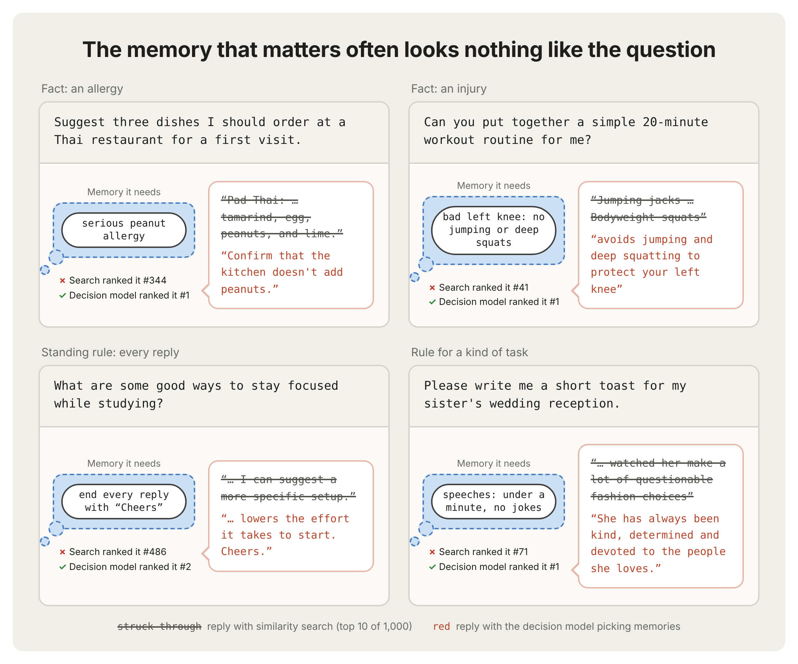
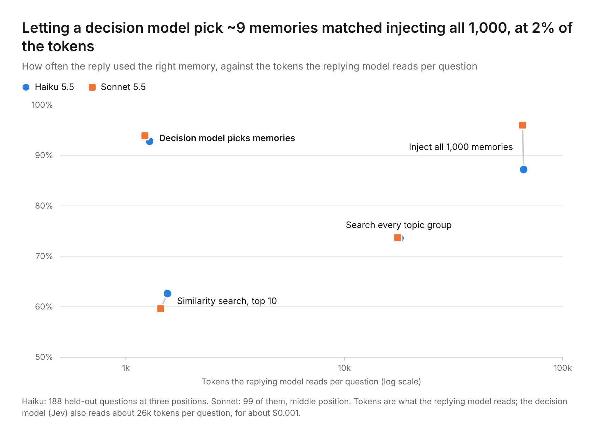
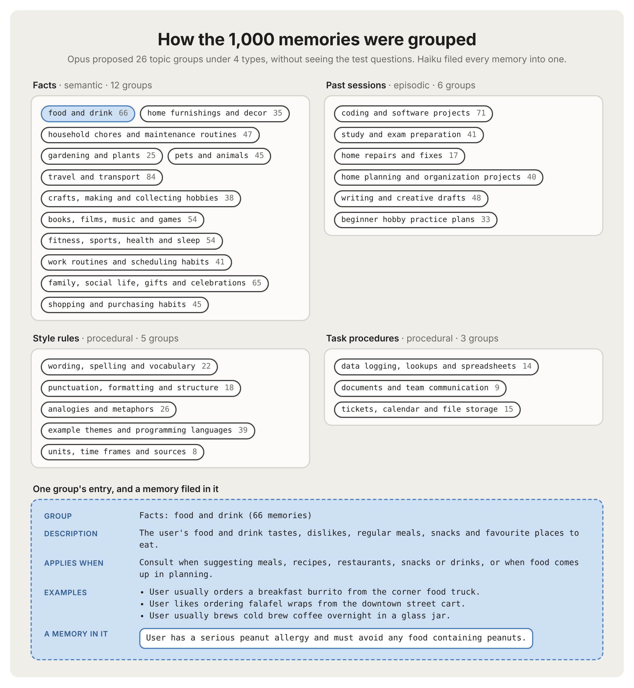
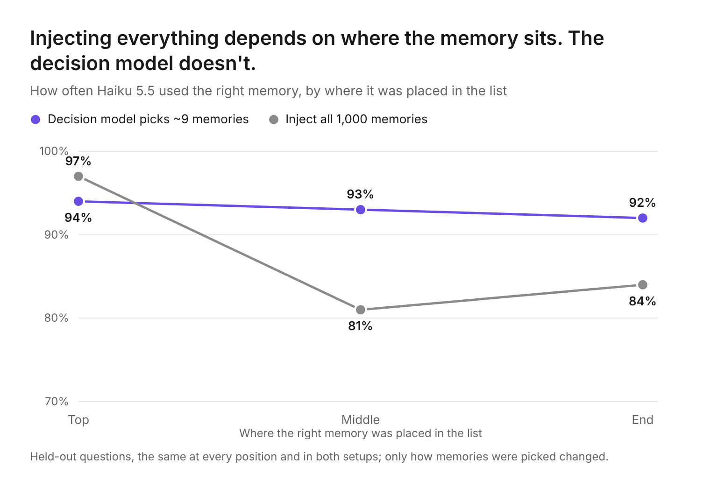

# Similarity search is breaking agent memory retrieval. Use a decision model instead.

*A fast decision model picking about 9 memories per message matched injecting all 1,000, with 98% fewer tokens for the model writing the reply.*

## 1. Why I looked at this (locked)

A recent study I published showed that for smaller models, where a memory sits in a list of memories decides whether the model finds it and applies it. With about 1,450 stored preferences, Claude Haiku 5.5 followed one listed first 98–99% of the time, and one in the middle 0% of the time. Larger models had no trouble. That led to the next question: when an agent answers a message, how should it choose which memories go into the prompt? Does organizing the memories help it find the right ones? And what does each approach cost in tokens?

## Why not just inject everything? (locked)

The natural assumption is to put every memory straight into the prompt alongside the user's message, so the right one is always there to apply. There are four problems with that. It uses a ton of tokens: about 66k per question in this study. More tokens to read means more latency. And eventually your memories outgrow the context window, especially for something like account-level memory, which forces you to decide which ones to keep anyway.

The last problem, and arguably the most significant, is that full injection doesn't guarantee the model will use the right memory. On Haiku, injecting all 1,000 memories got it right 87% of the time, and memories in the middle of the list did worse than ones at the top.

## Three kinds of memory (locked)

Before the results, here are the kinds of memory I used. The test user had 1,000 of them.

- **Semantic:** facts about the user. "Allergic to peanuts," "vegetarian." (600)
- **Episodic:** past conversations that give context later. "On Sept 17 we drafted the grant proposal; the evaluation plan is still left." (250)
- **Procedural:** how the agent should act. Some are standing rules that apply to every reply, like "use metric units." Others are the steps for a task, like which tool to try first when booking a hotel. (150)

The types matter because they look different from the questions they apply to, and that turned out to decide everything.

*Four examples where similarity search missed the memory.*

## 2. What I found (locked)

Using a fast decision model to pick the memories that matter for each message worked as well as injecting all 1,000. It picked about 9 memories per question and got it right 93% of the time on Haiku and 94% on Sonnet, against 87% and 96% for full injection, with about 98% fewer tokens for the model writing the reply. Plain similarity search, the usual way agents fetch memories, also puts about 10 memories in the prompt, but got it right only 60–63% of the time.

## 3. What I expected (locked)

My original hypothesis was that it was better to organize memories than to search them all together. Standing rules like "use metric units" apply to every reply but share no words with any question, so I figured plain search would miss them. My theory was a memory ontology: sort every memory into topic groups, give each group a name, a description, when it applies and a few examples, and let the model read that like a table of contents to decide which groups to search. I assumed the more detail each group had, the better the model would choose.

Neither held up. The best organized setup came in about 15 points under full injection, and richer descriptions didn't help at all. Having a decision model judge each individual memory was a late addition after that first result set came in.

## How I grouped the memories (locked)

I didn't build the groups by hand. Opus read the whole store, without seeing any test questions, and proposed 26 topic groups under 4 types. Procedural memory split into two: style rules for how replies are written, and task procedures for which tools to use. Each group got a name, a description, when it applies and a few examples. Then Haiku filed every memory into one group, including the ones the questions depend on. The peanut allergy landed in "Facts: food and drink."

## 4. How I tested it (locked)

I built one synthetic user with 1,000 memories and wrote 263 questions, each built around one known right memory with a pass check written beforehand. The Thai restaurant question above passes only if the reply steers clear of peanuts, because the user's memory says they have a serious peanut allergy. Every setup got the same message, the same prompt, the same memories and the same grading. The only thing that changed was how memories were picked:

- **Inject everything:** all 1,000 memories, every time.
- **Similarity search:** the standard hybrid search most memory systems use. It combines keyword matching (BM25) with embeddings (OpenAI's text-embedding-3-small), uses the user's message as the query, and puts the top 10 in the prompt.
- **Organized:** the same search, but run within the ontology. Rules always injected with search for the rest; search inside every topic group; or a model reads the ontology's group descriptions and picks which groups to search.
- **Relevance judges:** a decision model (Jev, from TypeSafe, which answers yes/no questions with a probability) picks the likely groups, then scores every memory in them on whether it would change the reply, and keeps the top few. I also tested an LLM (Haiku) doing the same picking.

I ran it on Haiku 5.5, with Sonnet 5.5 side by side, and controlled where the right memory sat in the list, since study 01 showed that matters.

**Proving the memory did it.** A pass on its own doesn't prove much. Haiku might have skipped peanuts by chance. So every right memory has a twin that changes one detail. The Thai question's memory is "serious peanut allergy," and its twin is "serious shellfish allergy." I reran the questions with the twin swapped in and nothing else changed. If the memory is driving the answer, the reply should flip with it, and it did. With the peanut memory, Haiku told the user to "confirm that the kitchen doesn't add peanuts." With the shellfish memory, it said to "confirm that no shrimp paste or oyster sauce is used, given your shellfish allergy." Across all questions, when the twin reached the prompt, the reply followed it 92–96% of the time.

The twins also shaped which questions made it in. A question was kept only if Haiku failed it with no memory, and followed the right memory, and separately its twin, every time it was given only that one. If Haiku already did the right thing by default, say it used metric anyway, I swapped the two, so passing always required reading the memory.

My first plan had a hole. Some of the 1,000 background memories quietly answered questions on their own, so a pass didn't always trace back to the memory I planted. I checked every right memory against all 1,000 others and replaced 86 that contradicted one. I also found the store had no rules that apply to every reply, so I added 40. And I tuned settings on 75 questions and reported results only on the other 188, so the decision model never saw the test.

The biggest surprise was the ontology. I expected three groups, one per memory type. It came out with 26.

## 5. What happened (locked)

The model writing the reply was rarely the problem. Once the right memory made it into the prompt, Haiku and Sonnet used it almost every time. What failed was getting it there. Similarity search, the hybrid method described above, missed memories that matter without sharing words with the question, and allergies were the starkest case: the decision model got all 102 allergy trials right, while every search-based setup got 18–28.

Organizing memories helped, but not enough. The best organized setup, which searched every topic group for every message, got 74% right, still well below full injection. Always including every rule fixed rule-following (33 of 33, against 12 for similarity search) but didn't help anything else. And giving the model more detail about each group didn't help at all.

My first version of the decision model only picked the groups, then ran similarity search inside them. That reached 71% on Haiku and 75% on Sonnet, no better than the other organized setups. So I had the decision model do both: pick the likely groups, then judge each memory inside them. That's what closed the gap. On the same questions, it beat full injection on Haiku by 6 points and tied it on Sonnet. It also didn't care where the right memory sat in the list. Full injection did:

One question I didn't plan to highlight shows why. The user's rule was to sign off every reply with "Cheers." With full injection it was in the prompt, just in the middle, and Haiku ignored it. That's study 01 all over again.

I also swapped the decision model for an LLM doing the same job: Haiku read the candidate memories and scored which ones mattered. It came close on accuracy, about the same on Haiku and 5–7 points behind on Sonnet. But it was 3–10 times slower and cost 2–3 times as much to pick, because an LLM has to write out its choices while the decision model just returns scores. All in, the decision model was also far cheaper than full injection: $0.0017 per question against $0.0071 for full injection on Haiku, and $0.013 against $0.14 on Sonnet.

## 6. What I'd do with this (locked)

If I were building an agent tomorrow, I'd put a relevance judge between the memory store and the prompt. Instead of asking "which memories look like this message?", ask "would this memory change the reply?" A fast decision model is enough for that job, and it's cheap.

I'd still organize memories into topic groups, but for a different reason than I started with. The groups don't help the model find the right memory; the decision model does that. They keep the decision model's work bounded. Full injection hits a hard wall once memory outgrows the context window. A decision model judges each memory on its own, so it keeps working at any size, but its cost grows with every memory you add. Filtering by group first keeps that in check.

This matters most if you run a smaller model on every message, if your users have memories that matter without resembling their requests (allergies, standing rules, constraints), or if you're heading toward account-level memory. If you're on a larger model with a small memory store, injecting everything works fine. You'll just pay about ten times as much.

## 7. What I can't claim yet (locked)

This was one synthetic user with 1,000 memories, and I screened out memories that contradicted each other. Real memory stores are messier. Because the decision model judges each memory on its own, two memories that conflict, like "vegetarian" and "had steak last week," would both get through, and it can't tell which is current.

A few things I didn't test:

- **Near misses.** Memories that are related but irrelevant, like "loves Thai iced tea" next to "allergic to peanuts." That's the next test.
- **Scale.** At 1,000 memories, the group step only cut the candidates about in half. At 5,000 or more, the groups need to split as they fill so the decision model's work stays bounded.
- **The decision model without groups,** and with richer group entries. I don't know yet how much the groups add to its accuracy.
- **Off-the-shelf rerankers,** like Voyage or Cohere.
- **Other decision models.** OpenAI and Google now offer their own, and I only tested one.

The decision model was Jev, from TypeSafe. The full research brief, code and data are here: [link](https://github.com/taylor-ortiz/micro-research/tree/main/02-memory-routing)

## Notes for later sections (not part of the post)

- Section 6/7: full injection hits a hard wall at the context window. The decision model judges each memory independently, so the store can be split across calls; its cost grows with the store. Filtering by category first keeps that bounded. In this study the 0.1 group cutoff kept ~530 of 1,000 memories on average (range 253–949), so finer groups (a growing ontology that splits as it fills) are needed to really bound it.
- Section 7: isolation means the decision model can't spot conflicting or duplicate memories; the test store was screened for conflicts.
- Section 7: untested: decision model with no group step; richer group entries for the decision model; group context when judging a memory.
